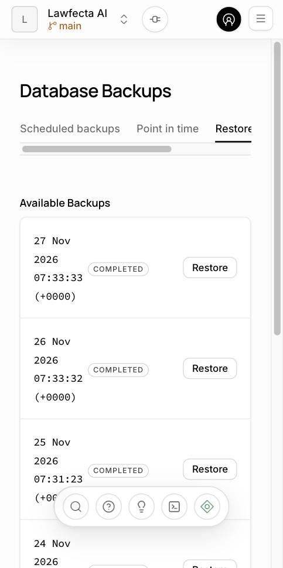
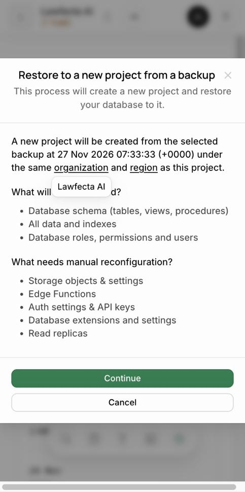
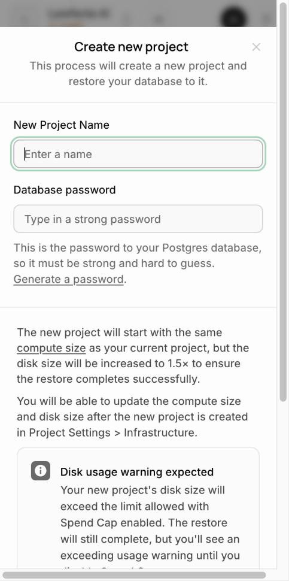
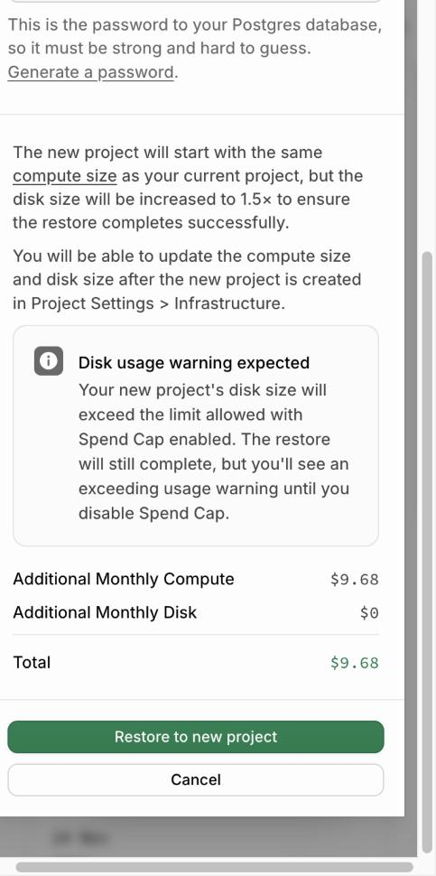

# Recovery: getting DELA's data back from a backup

Written 2026-11-25 after the audit (step 93). Status: no drill has been run. On 2026-11-27 the steps were walked through in Supabase as far as the screen that shows the cost (the pictures below), and Stacey decided not to pay for a test copy for now. The panel was cancelled; nothing was created. The same steps are in the admin area: Guide, "Getting data back from a backup". Until one drill is done, a restore is unproven.

## What is backed up, and what is not
- **The database** (members' workspaces, documents, gigs, agreements, messages, the ledger, settings): Supabase makes a backup every day by itself. The project is on the Pro plan.
- **Files members uploaded** (in Supabase Storage): not in the database backup. They stay in the project's storage. A database restore does not change them.
- **The code**: in GitHub. Every released version can be put back by its commit.
- **Secrets** (keys for Stripe, the website, Brevo, the AI providers): kept in Supabase's secrets. A copy made from a backup does not carry them.
- **Members' logins and plans**: on the website (Brilliant Directories), which has its own backups.

## What we can lose, and how long it takes
- With daily backups, a restore brings back the database as it was at the last backup. Up to 24 hours of work can be lost.
- Point-in-time recovery (back to any minute) is a paid Supabase add-on. It is worth turning on before real money moves every day. That is Stacey's decision; nothing here turns it on.
- A restore of the live project takes it offline while it runs (minutes for a database this size).

## The two cases

### Case 1: a drill, or "I want to look at yesterday's data" (safe, changes nothing on the live site)
Supabase makes a **new, separate copy** of the database from a backup. The live site is not touched. The copy costs money while it exists, so it is paused or deleted after the check.

The five steps:
1. **Open the backups page.** Go to https://supabase.com/dashboard/project/ojshgsxgsypbywtqhkch/database/backups/restore-to-new-project and sign in. The page title is "Database Backups". The tab "Restore to new project" is the marked one.

   
2. **Choose the backup.** In the list of backups, find the newest one (the top line, with today's or yesterday's date) and click the "Restore" button at the right end of that line. A panel says what is copied and what is not; click "Continue".

   
3. **Read the cost and confirm.** A panel shows the name of the new project and what it costs each month. Type a name such as "DELA restore drill" in "New Project Name" and click "Generate a password". On 2026-11-27 the cost read 9.68 US dollars a month. Click the green button "Restore to new project" at the bottom of the panel. Only Stacey clicks this, because it spends money.

   

   
4. **Wait, then tell Claude.** The new project shows in the list at https://supabase.com/dashboard/projects with the word "Restoring" and then a green dot. This takes a few minutes. Then write to Claude: "the restore is done".
5. **Claude checks the copy and you remove it.** Claude counts the members, workspaces, documents, gigs, agreements, messages and ledger lines in the copy and compares them with the live site, and writes the result in docs/restore-drills.md. Then open the copy's own page, "Project Settings" at the bottom of the left menu, "General", and click "Pause project" (or "Delete project" at the bottom of that page). Check the name at the top says the copy's name, not "Lawfecta AI", before you click.

### Case 2: the live data is damaged and must go back (changes the live site)
Only Stacey starts this, and only after Claude has said in writing what would be lost.
1. In the DELA admin area, turn on the emergency pause, so nobody writes while the data goes back.
2. Go to https://supabase.com/dashboard/project/ojshgsxgsypbywtqhkch/database/backups/scheduled (tab "Scheduled backups").
3. Find the last backup from before the damage and click "Restore" on that line. Read the warning: everything written after that backup is lost. Confirm.
4. Wait until the project shows a green dot again. Tell Claude.
5. Claude checks the counts, the health address and the last migration, puts back any database change released after the backup, and then you turn the pause off.

## If the whole project is lost
The copy from Case 1 becomes the new home. It needs, in this order: the server function deployed again (Claude), every secret typed in again (Stacey, the list is at the top of supabase/functions/api/index.ts), the minute-by-minute worker schedule (Claude), and the three website widgets pointed at the new address (Stacey, with the widget code Claude sends). Files that members uploaded are not in the copy.

## How Claude checks a copy
The same read-only count runs on the live project and on the copy: people, workspaces (side_profiles), documents (playbooks) and their versions, gigs, agreements, messages, ledger lines, settings, switches, and the newest recorded migration. Numbers in the copy equal the live numbers as they were at the time of the backup; rows made since then are the only difference, and they are listed.

## How often
One drill every three months, and one after any change to how backups work. Each drill gets a line in docs/restore-drills.md.
